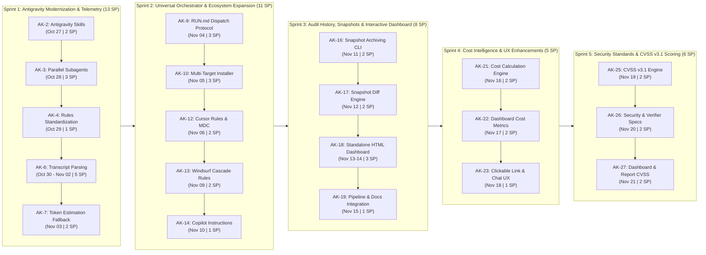

# Product Backlog & Roadmap: Universal AI First-Class Support

**Jira Project:** [audit-kit (AK)](https://victorsfl.atlassian.net/browse/AK-1)  
**Total Effort:** 43 Story Points (~21 business days across 5 Sprints)  
**Target Timeline:** 2026-10-27 to 2026-11-21  
**Objective:** Evolve `audit-kit` into a 100% first-class citizen across all major AI agent ecosystems (Antigravity, Claude Code, Gemini CLI, Cursor, Windsurf, GitHub Copilot) with native snapshot history, interactive dashboard visualization, automated audit cost calculation, and industry-standard CVSS v3.1 security vulnerability scoring.

---

## Roadmap Overview

---

## Timeline & Estimates Table

| Key | Type | Summary | Story Points | Duration | Start Date | Due Date | Status |
| :--- | :--- | :--- | :---: | :---: | :---: | :---: | :---: |
| [AK-1](https://victorsfl.atlassian.net/browse/AK-1) | **Epic** | **Phase 1: Antigravity Full Parity & Modernization** | **6 SP** | **~3 days** | **2026-10-27** | **2026-10-29** | Done |
| [AK-2](https://victorsfl.atlassian.net/browse/AK-2) | Task | AK-1.1: Migrate Antigravity adapter to modern Skills (`.agents/skills/`) | 2 SP | 4–6 hrs | 2026-10-27 | 2026-10-27 | Done |
| [AK-3](https://victorsfl.atlassian.net/browse/AK-3) | Task | AK-1.2: Implement native parallel subagents in Antigravity | 3 SP | 1 day | 2026-10-28 | 2026-10-28 | Done |
| [AK-4](https://victorsfl.atlassian.net/browse/AK-4) | Task | AK-1.3: Standardize rules injection for Antigravity (`GEMINI.md` / `.agents/rules/`) | 1 SP | 2–3 hrs | 2026-10-29 | 2026-10-29 | Done |
| [AK-5](https://victorsfl.atlassian.net/browse/AK-5) | **Epic** | **Phase 2: Agnostic Token Telemetry** | **7 SP** | **~2.5 days** | **2026-10-30** | **2026-11-03** | Done |
| [AK-6](https://victorsfl.atlassian.net/browse/AK-6) | Task | AK-2.1: Antigravity session and transcript parsing in `usage_report.py` | 5 SP | 1.5–2 days | 2026-10-30 | 2026-11-02 | Done |
| [AK-7](https://victorsfl.atlassian.net/browse/AK-7) | Task | AK-2.2: Implement deterministic estimation fallback for token usage | 2 SP | 4–6 hrs | 2026-11-03 | 2026-11-03 | Done |
| [AK-8](https://victorsfl.atlassian.net/browse/AK-8) | **Epic** | **Phase 3: Orchestrator & Installer Standardization** | **6 SP** | **~2 days** | **2026-11-04** | **2026-11-05** | Done |
| [AK-9](https://victorsfl.atlassian.net/browse/AK-9) | Task | AK-3.1: Universal subagent dispatch protocol in `RUN.md` | 3 SP | 1 day | 2026-11-04 | 2026-11-04 | Done |
| [AK-10](https://victorsfl.atlassian.net/browse/AK-10) | Task | AK-3.2: Update `install.sh` and `get.sh` with multi-target & auto-migration | 3 SP | 1 day | 2026-11-05 | 2026-11-05 | Done |
| [AK-11](https://victorsfl.atlassian.net/browse/AK-11) | **Epic** | **Phase 4: Expansion to Other AI Environments** | **5 SP** | **~3 days** | **2026-11-06** | **2026-11-10** | Done |
| [AK-12](https://victorsfl.atlassian.net/browse/AK-12) | Task | AK-4.1: Cursor adapter and rules (`.cursorrules` / `.cursor/rules/*.mdc`) | 2 SP | 4–6 hrs | 2026-11-06 | 2026-11-06 | Done |
| [AK-13](https://victorsfl.atlassian.net/browse/AK-13) | Task | AK-4.2: Windsurf Cascade adapter and rules (`.windsurfrules`) | 2 SP | 4–6 hrs | 2026-11-09 | 2026-11-09 | Done |
| [AK-14](https://victorsfl.atlassian.net/browse/AK-14) | Task | AK-4.3: GitHub Copilot adapter (`.github/copilot-instructions.md`) | 1 SP | 2–3 hrs | 2026-11-10 | 2026-11-10 | Done |
| [AK-15](https://victorsfl.atlassian.net/browse/AK-15) | **Epic** | **Phase 5: Audit History, Snapshots & Interactive Dashboard** | **8 SP** | **~3.5 days** | **2026-11-11** | **2026-11-15** | Done |
| [AK-16](https://victorsfl.atlassian.net/browse/AK-16) | Task | AK-5.1: Snapshot archiving system and CLI (`tools/snapshot.py`) | 2 SP | 4–6 hrs | 2026-11-11 | 2026-11-11 | Done |
| [AK-17](https://victorsfl.atlassian.net/browse/AK-17) | Task | AK-5.2: Snapshot comparison and audit diff engine (`tools/snapshot.py compare`) | 2 SP | 4–6 hrs | 2026-11-12 | 2026-11-12 | Done |
| [AK-18](https://victorsfl.atlassian.net/browse/AK-18) | Task | AK-5.3: Standalone HTML/CSS/JS audit dashboard generator (`tools/generate_dashboard.py`) | 3 SP | 1–1.5 days | 2026-11-13 | 2026-11-14 | Done |
| [AK-19](https://victorsfl.atlassian.net/browse/AK-19) | Task | AK-5.4: Pipeline integration in RUN.md, adapters, installer and documentation | 1 SP | 2–3 hrs | 2026-11-15 | 2026-11-15 | Done |
| [AK-20](https://victorsfl.atlassian.net/browse/AK-20) | **Epic** | **Phase 6: Audit Cost Calculation & UX Enhancements** | **5 SP** | **~2.5 days** | **2026-11-16** | **2026-11-18** | Done |
| [AK-21](https://victorsfl.atlassian.net/browse/AK-21) | Task | AK-6.1: Cost calculation engine and pricing matrix in `usage_report.py` | 2 SP | 4–6 hrs | 2026-11-16 | 2026-11-16 | Done |
| [AK-22](https://victorsfl.atlassian.net/browse/AK-22) | Task | AK-6.2: Financial cost card & metrics in HTML dashboard & generator | 2 SP | 4–6 hrs | 2026-11-17 | 2026-11-17 | Done |
| [AK-23](https://victorsfl.atlassian.net/browse/AK-23) | Task | AK-6.3: One-click `file://` dashboard link & cost reporting in `RUN.md` | 1 SP | 2–3 hrs | 2026-11-18 | 2026-11-18 | Done |
| [AK-24](https://victorsfl.atlassian.net/browse/AK-24) | **Epic** | **Phase 7: Security Standards & CVSS v3.1 Scoring** | **6 SP** | **~2.5 days** | **2026-11-19** | **2026-11-21** | Done |
| [AK-25](https://victorsfl.atlassian.net/browse/AK-25) | Task | AK-7.1: CVSS v3.1 calculation engine and validator (`tools/cvss.py`) | 2 SP | 4–6 hrs | 2026-11-19 | 2026-11-19 | Done |
| [AK-26](https://victorsfl.atlassian.net/browse/AK-26) | Task | AK-7.2: Update security auditor and skeptic verifier specifications | 2 SP | 4–6 hrs | 2026-11-20 | 2026-11-20 | Done |
| [AK-27](https://victorsfl.atlassian.net/browse/AK-27) | Task | AK-7.3: Render CVSS badges and vector metrics in HTML dashboard & reports | 2 SP | 4–6 hrs | 2026-11-21 | 2026-11-21 | Done |

---

## Detailed Phases & Tickets

### Phase 1: Antigravity Full Parity & Modernization ([AK-1](https://victorsfl.atlassian.net/browse/AK-1))
**Target Dates:** 2026-10-27 – 2026-10-29 | **Effort:** 6 SP  
Achieve full capability parity between Google Antigravity / Gemini and Claude Code by upgrading from legacy workflows to modern Skills, enabling true parallel subagents, and standardizing rule discovery.

* **[AK-2](https://victorsfl.atlassian.net/browse/AK-2) – AK-1.1: Migrate Antigravity adapter to modern Skills (`.agents/skills/`)**
  * **Scope:** Replace or complement legacy `.agents/workflows/*.md` with Antigravity Skills:
    * `.agents/skills/audit/SKILL.md`
    * `.agents/skills/audit-full/SKILL.md`
    * `.agents/skills/audit-diff/SKILL.md`
    * `.agents/skills/audit-jira/SKILL.md`
    * `.agents/skills/audit-check-update/SKILL.md`
  * **Acceptance Criteria:** Typing `/audit`, `/audit-full`, etc. triggers the corresponding skill with proper parameter validation and progressive disclosure.

* **[AK-3](https://victorsfl.atlassian.net/browse/AK-3) – AK-1.2: Implement native parallel subagents in Antigravity**
  * **Scope:** Provide explicit orchestrator templates and prompts for Antigravity to launch parallel subagents using `invoke_subagent` (with role, prompt prefix `audit-kit-agent: <name>`, and isolated execution context), achieving the same context hygiene as Claude Code.
  * **Acceptance Criteria:** Antigravity manager can dispatch all active auditors concurrently without context leakage.

* **[AK-4](https://victorsfl.atlassian.net/browse/AK-4) – AK-1.3: Standardize rules injection for Antigravity**
  * **Scope:** Ensure `install.sh` injects rules into `GEMINI.md` and `.agents/rules/audit-rules.md` in addition to `AGENTS.md`.
  * **Acceptance Criteria:** Antigravity discovers and strictly enforces read-only auditor constraints automatically upon opening the workspace.

---

### Phase 2: Agnostic Token Telemetry ([AK-5](https://victorsfl.atlassian.net/browse/AK-5))
**Target Dates:** 2026-10-30 – 2026-11-03 | **Effort:** 7 SP  
Eliminate the single-platform dependency on Claude Code's session files in `tools/usage_report.py`.

* **[AK-6](https://victorsfl.atlassian.net/browse/AK-6) – AK-2.1: Antigravity session and transcript parsing in `usage_report.py`**
  * **Scope:** Add support for detecting and parsing Antigravity transcript files (`.system_generated/logs/transcript.jsonl` or local session logs) to extract exact input, output, and cached tokens attributed by `audit-kit-agent:` headers.
  * **Acceptance Criteria:** Running `usage_report.py` in an Antigravity environment returns real token figures instead of `"available": false`.

* **[AK-7](https://victorsfl.atlassian.net/browse/AK-7) – AK-2.2: Implement deterministic estimation fallback for token usage**
  * **Scope:** For environments without accessible local session logs (e.g., standard Gemini CLI, generic agent terminals), calculate an accurate estimate using `size_check.py` code size + prompt templates + generated report length.
  * **Acceptance Criteria:** Returns JSON with structured token counts and `"estimated": true`, ensuring `findings.json` and `audit-tracker.xlsx` always record metrics.

---

### Phase 3: Orchestrator & Installer Standardization ([AK-8](https://victorsfl.atlassian.net/browse/AK-8))
**Target Dates:** 2026-11-04 – 2026-11-05 | **Effort:** 6 SP  
Refactor orchestrator documentation and installation automation to eliminate platform-specific biases.

* **[AK-9](https://victorsfl.atlassian.net/browse/AK-9) – AK-3.1: Universal subagent dispatch protocol in `RUN.md`**
  * **Scope:** Restructure Section 3 of `RUN.md` to cleanly separate execution strategies:
    1. *Claude Code:* Dispatch via predefined `.claude/agents/*-auditor.md`.
    2. *Antigravity:* Dispatch via `invoke_subagent`.
    3. *Single-threaded / sequential agents:* Step-by-step isolated execution with clean file rereads.
  * **Acceptance Criteria:** Any LLM reading `RUN.md` immediately understands how to execute according to its native capabilities.

* **[AK-10](https://victorsfl.atlassian.net/browse/AK-10) – AK-3.2: Update `install.sh` and `get.sh` with multi-target & auto-migration**
  * **Scope:** Update installer scripts to support modern Antigravity skills, detect existing legacy workflows, upgrade them safely, and support command-line targets (`--target [all|claude|antigravity|gemini]`).
  * **Acceptance Criteria:** `curl | bash` cleanly installs appropriate modern files based on selected or detected tooling.

---

### Phase 4: Expansion to Other AI Environments ([AK-11](https://victorsfl.atlassian.net/browse/AK-11))
**Target Dates:** 2026-11-06 – 2026-11-10 | **Effort:** 5 SP  
Add plug-and-play adapter support for the remaining major AI coding IDEs.

* **[AK-12](https://victorsfl.atlassian.net/browse/AK-12) – AK-4.1: Cursor adapter and rules (`.cursorrules` / `.cursor/rules/*.mdc`)**
  * **Scope:** Add `adapters/cursor/` with MDC rule files directing Cursor's Composer/Agent to follow `audit-kit/RUN.md` and enforce read-only execution.
  * **Acceptance Criteria:** Typing `/audit` or referencing audit-kit in Cursor activates the audit protocol.

* **[AK-13](https://victorsfl.atlassian.net/browse/AK-13) – AK-4.2: Windsurf Cascade adapter and rules (`.windsurfrules`)**
  * **Scope:** Add `adapters/windsurf/` containing `.windsurfrules` configuration for Codeium Windsurf Cascade.
  * **Acceptance Criteria:** Cascade cleanly runs audit steps without modifying project source code.

* **[AK-14](https://victorsfl.atlassian.net/browse/AK-14) – AK-4.3: GitHub Copilot adapter (`.github/copilot-instructions.md`)**
  * **Scope:** Add `adapters/copilot/` with repository-level Copilot guidelines pointing to `audit-kit/RUN.md`.
  * **Acceptance Criteria:** Copilot Chat and CLI understand and respect audit-kit rules.

---

### Phase 5: Audit History, Snapshots & Interactive Dashboard ([AK-15](https://victorsfl.atlassian.net/browse/AK-15))
**Target Dates:** 2026-11-11 – 2026-11-15 | **Effort:** 8 SP  
Provide historical traceability, snapshot archiving, diff comparisons between audit runs, and a self-contained interactive HTML/CSS/JS dashboard.

* **[AK-16](https://victorsfl.atlassian.net/browse/AK-16) – AK-5.1: Snapshot archiving system and CLI (`tools/snapshot.py`)**
  * **Scope:** Create `tools/snapshot.py` to automatically copy prior `audit/` outputs to `audit/snapshots/<TIMESTAMP>_<COMMIT>/` before fresh or incremental runs, extract summary metadata, and list historical snapshots.
  * **Acceptance Criteria:** Prior audits are archived non-destructively; `audit/project-context.md` remains at root.

* **[AK-17](https://victorsfl.atlassian.net/browse/AK-17) – AK-5.2: Snapshot comparison and audit diff engine (`tools/snapshot.py compare`)**
  * **Scope:** Implement diff engine comparing current audit against a snapshot (or two snapshots): delta scores per dimension, resolved findings, newly introduced findings, and persistent findings.
  * **Acceptance Criteria:** CLI outputs structured summary and JSON format for integration.

* **[AK-18](https://victorsfl.atlassian.net/browse/AK-18) – AK-5.3: Standalone HTML/CSS/JS audit dashboard generator (`tools/generate_dashboard.py`)**
  * **Scope:** Implement zero-dependency, self-contained dashboard generator outputting `audit/dashboard.html`. Includes executive cards, radar/bar SVG scores, interactive searchable/filterable findings table, finding details modal, and historical trend timeline.
  * **Acceptance Criteria:** Opens cleanly via `file://` in any modern browser without local server or CDN internet connection.

* **[AK-19](https://victorsfl.atlassian.net/browse/AK-19) – AK-5.4: Pipeline integration in RUN.md, adaptadores, installer and documentation**
  * **Scope:** Wire `tools/snapshot.py` into step 1 of `RUN.md` and `tools/generate_dashboard.py` into final steps. Add slash commands (`/audit-dashboard`), update `install.sh`, `get.sh`, `README.md`, and `docs/GUIDE.md`.
  * **Acceptance Criteria:** Every audit automatically produces an updated `dashboard.html` and preserves snapshots without user intervention.

---

### Phase 6: Audit Cost Calculation & UX Enhancements ([AK-20](https://victorsfl.atlassian.net/browse/AK-20))
**Target Dates:** 2026-11-16 – 2026-11-18 | **Effort:** 5 SP  
Automate calculation of audit cost (USD) based on tokens consumed and AI model used, display financial metrics in the HTML dashboard, and deliver a one-click `file://` link upon audit completion.

* **[AK-21](https://victorsfl.atlassian.net/browse/AK-21) – AK-6.1: Cost calculation engine and pricing matrix in `usage_report.py`**
  * **Scope:** Implement model pricing matrix (Claude, Gemini, GPT) and auto-compute USD costs for input, output, and cache operations.
  * **Acceptance Criteria:** `usage_report.py` JSON output includes detailed `cost` object with formatted total and itemized breakdown.

* **[AK-22](https://victorsfl.atlassian.net/browse/AK-22) – AK-6.2: Financial cost card & metrics in HTML dashboard & generator**
  * **Scope:** Add prominent Audit Cost card to `templates/dashboard.html` overview grid, snapshot comparison table, and feed from `generate_dashboard.py`.
  * **Acceptance Criteria:** Dashboard visually displays estimated audit cost and cost evolution across snapshots.

* **[AK-23](https://victorsfl.atlassian.net/browse/AK-23) – AK-6.3: One-click `file://` dashboard link & cost reporting in `RUN.md`**
  * **Scope:** Update `RUN.md` reporting step to output absolute clickable markdown link `[Open Dashboard](file:///...)` and audit cost in chat summary.
  * **Acceptance Criteria:** User can click link directly in chat to open `dashboard.html` in browser.

---

### Phase 7: Security Standards & CVSS v3.1 Scoring ([AK-24](https://victorsfl.atlassian.net/browse/AK-24))
**Target Dates:** 2026-11-19 – 2026-11-21 | **Effort:** 6 SP  
Introduce official FIRST.org CVSS v3.1 Base Score calculation, vector serialization, skeptic verification guidelines, and interactive dashboard badges for security findings.

* **[AK-25](https://victorsfl.atlassian.net/browse/AK-25) – AK-7.1: CVSS v3.1 calculation engine and validator (`tools/cvss.py`)**
  * **Scope:** Implement official FIRST.org mathematical formula for CVSS v3.1 Base Score, vector parser/validator, and CLI tool.
  * **Acceptance Criteria:** Correctly scores standard test vectors (e.g. Heartbleed, SQLi, XSS) with comprehensive unit tests.

* **[AK-26](https://victorsfl.atlassian.net/browse/AK-26) – AK-7.2: Update security auditor and skeptic verifier specifications**
  * **Scope:** Update `agents/security.md` and report templates to compute CVSS vector for each `SEC-NNN` finding. Guide `agents/skeptic-verifier.md` to challenge attack vector metrics.
  * **Acceptance Criteria:** Security findings contain full CVSS v3.1 vector string and numeric score.

* **[AK-27](https://victorsfl.atlassian.net/browse/AK-27) – AK-7.3: Render CVSS badges and vector metrics in HTML dashboard & reports**
  * **Scope:** Add CVSS badge pills and vector inspection modals/tooltips in `templates/dashboard.html` and `findings.json`.
  * **Acceptance Criteria:** Security cards in the dashboard clearly display colored CVSS scores and vector details.
