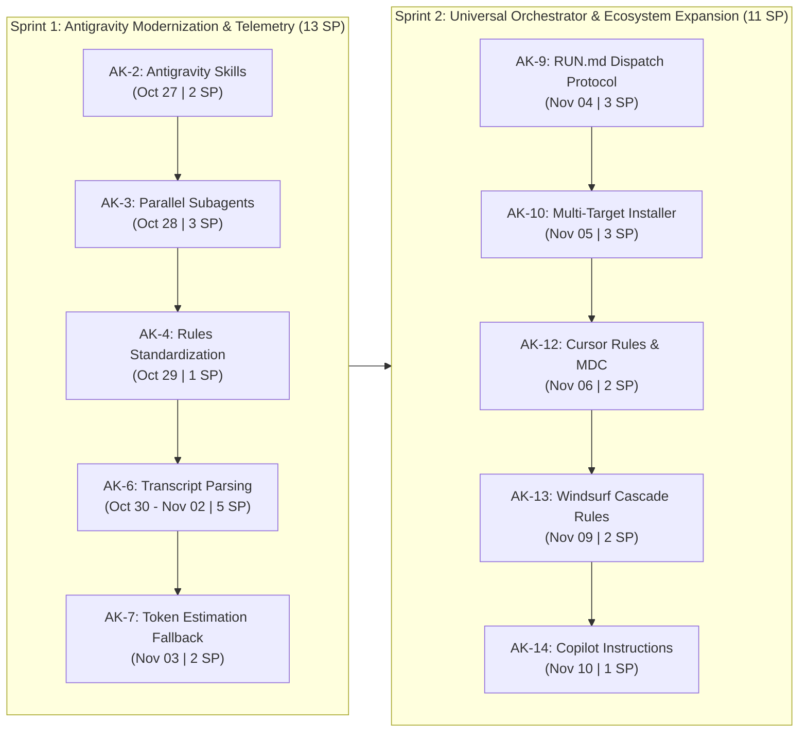

# Product Backlog & Roadmap: Universal AI First-Class Support

**Jira Project:** [audit-kit (AK)](https://victorsfl.atlassian.net/browse/AK-1)  
**Total Effort:** 24 Story Points (~11 business days across 2 Sprints)  
**Target Timeline:** 2026-10-27 to 2026-11-10  
**Objective:** Evolve `audit-kit` into a 100% first-class citizen across all major AI agent ecosystems (Antigravity, Claude Code, Gemini CLI, Cursor, Windsurf, GitHub Copilot) without platform bias.

---

## Roadmap Overview

---

## Timeline & Estimates Table

| Key | Type | Summary | Story Points | Duration | Start Date | Due Date | Status |
| :--- | :--- | :--- | :---: | :---: | :---: | :---: | :---: |
| [AK-1](https://victorsfl.atlassian.net/browse/AK-1) | **Epic** | **Phase 1: Antigravity Full Parity & Modernization** | **6 SP** | **~3 days** | **2026-10-27** | **2026-10-29** | To Do |
| [AK-2](https://victorsfl.atlassian.net/browse/AK-2) | Task | AK-1.1: Migrate Antigravity adapter to modern Skills (`.agents/skills/`) | 2 SP | 4–6 hrs | 2026-10-27 | 2026-10-27 | To Do |
| [AK-3](https://victorsfl.atlassian.net/browse/AK-3) | Task | AK-1.2: Implement native parallel subagents in Antigravity | 3 SP | 1 day | 2026-10-28 | 2026-10-28 | To Do |
| [AK-4](https://victorsfl.atlassian.net/browse/AK-4) | Task | AK-1.3: Standardize rules injection for Antigravity (`GEMINI.md` / `.agents/rules/`) | 1 SP | 2–3 hrs | 2026-10-29 | 2026-10-29 | To Do |
| [AK-5](https://victorsfl.atlassian.net/browse/AK-5) | **Epic** | **Phase 2: Agnostic Token Telemetry** | **7 SP** | **~2.5 days** | **2026-10-30** | **2026-11-03** | To Do |
| [AK-6](https://victorsfl.atlassian.net/browse/AK-6) | Task | AK-2.1: Antigravity session and transcript parsing in `usage_report.py` | 5 SP | 1.5–2 days | 2026-10-30 | 2026-11-02 | To Do |
| [AK-7](https://victorsfl.atlassian.net/browse/AK-7) | Task | AK-2.2: Implement deterministic estimation fallback for token usage | 2 SP | 4–6 hrs | 2026-11-03 | 2026-11-03 | To Do |
| [AK-8](https://victorsfl.atlassian.net/browse/AK-8) | **Epic** | **Phase 3: Orchestrator & Installer Standardization** | **6 SP** | **~2 days** | **2026-11-04** | **2026-11-05** | To Do |
| [AK-9](https://victorsfl.atlassian.net/browse/AK-9) | Task | AK-3.1: Universal subagent dispatch protocol in `RUN.md` | 3 SP | 1 day | 2026-11-04 | 2026-11-04 | To Do |
| [AK-10](https://victorsfl.atlassian.net/browse/AK-10) | Task | AK-3.2: Update `install.sh` and `get.sh` with multi-target & auto-migration | 3 SP | 1 day | 2026-11-05 | 2026-11-05 | To Do |
| [AK-11](https://victorsfl.atlassian.net/browse/AK-11) | **Epic** | **Phase 4: Expansion to Other AI Environments** | **5 SP** | **~3 days** | **2026-11-06** | **2026-11-10** | To Do |
| [AK-12](https://victorsfl.atlassian.net/browse/AK-12) | Task | AK-4.1: Cursor adapter and rules (`.cursorrules` / `.cursor/rules/*.mdc`) | 2 SP | 4–6 hrs | 2026-11-06 | 2026-11-06 | To Do |
| [AK-13](https://victorsfl.atlassian.net/browse/AK-13) | Task | AK-4.2: Windsurf Cascade adapter and rules (`.windsurfrules`) | 2 SP | 4–6 hrs | 2026-11-09 | 2026-11-09 | To Do |
| [AK-14](https://victorsfl.atlassian.net/browse/AK-14) | Task | AK-4.3: GitHub Copilot adapter (`.github/copilot-instructions.md`) | 1 SP | 2–3 hrs | 2026-11-10 | 2026-11-10 | To Do |

---

## Detailed Phases & Tickets

### Phase 1: Antigravity Full Parity & Modernization ([AK-1](https://victorsfl.atlassian.net/browse/AK-1))
**Target Dates:** 2026-10-27 – 2026-10-29 | **Effort:** 6 SP  
Achieve full capability parity between Google Antigravity / Gemini and Claude Code by upgrading from legacy workflows to modern Skills, enabling true parallel subagents, and standardizing rule discovery.

* **[AK-2](https://victorsfl.atlassian.net/browse/AK-2) – AK-1.1: Migrate Antigravity adapter to modern Skills (`.agents/skills/`)**
  * **Scope:** Replace or complement legacy `.agents/workflows/*.md` with Antigravity Skills:
    * `.agents/skills/audit/SKILL.md`
    * `.agents/skills/audit-full/SKILL.md`
    * `.agents/skills/audit-diff/SKILL.md`
    * `.agents/skills/audit-jira/SKILL.md`
    * `.agents/skills/audit-check-update/SKILL.md`
  * **Acceptance Criteria:** Typing `/audit`, `/audit-full`, etc. triggers the corresponding skill with proper parameter validation and progressive disclosure.

* **[AK-3](https://victorsfl.atlassian.net/browse/AK-3) – AK-1.2: Implement native parallel subagents in Antigravity**
  * **Scope:** Provide explicit orchestrator templates and prompts for Antigravity to launch parallel subagents using `invoke_subagent` (with role, prompt prefix `audit-kit-agent: <name>`, and isolated execution context), achieving the same context hygiene as Claude Code.
  * **Acceptance Criteria:** Antigravity manager can dispatch all active auditors concurrently without context leakage.

* **[AK-4](https://victorsfl.atlassian.net/browse/AK-4) – AK-1.3: Standardize rules injection for Antigravity**
  * **Scope:** Ensure `install.sh` injects rules into `GEMINI.md` and `.agents/rules/audit-rules.md` in addition to `AGENTS.md`.
  * **Acceptance Criteria:** Antigravity discovers and strictly enforces read-only auditor constraints automatically upon opening the workspace.

---

### Phase 2: Agnostic Token Telemetry ([AK-5](https://victorsfl.atlassian.net/browse/AK-5))
**Target Dates:** 2026-10-30 – 2026-11-03 | **Effort:** 7 SP  
Eliminate the single-platform dependency on Claude Code's session files in `tools/usage_report.py`.

* **[AK-6](https://victorsfl.atlassian.net/browse/AK-6) – AK-2.1: Antigravity session and transcript parsing in `usage_report.py`**
  * **Scope:** Add support for detecting and parsing Antigravity transcript files (`.system_generated/logs/transcript.jsonl` or local session logs) to extract exact input, output, and cached tokens attributed by `audit-kit-agent:` headers.
  * **Acceptance Criteria:** Running `usage_report.py` in an Antigravity environment returns real token figures instead of `"available": false`.

* **[AK-7](https://victorsfl.atlassian.net/browse/AK-7) – AK-2.2: Implement deterministic estimation fallback for token usage**
  * **Scope:** For environments without accessible local session logs (e.g., standard Gemini CLI, generic agent terminals), calculate an accurate estimate using `size_check.py` code size + prompt templates + generated report length.
  * **Acceptance Criteria:** Returns JSON with structured token counts and `"estimated": true`, ensuring `findings.json` and `audit-tracker.xlsx` always record metrics.

---

### Phase 3: Orchestrator & Installer Standardization ([AK-8](https://victorsfl.atlassian.net/browse/AK-8))
**Target Dates:** 2026-11-04 – 2026-11-05 | **Effort:** 6 SP  
Refactor orchestrator documentation and installation automation to eliminate platform-specific biases.

* **[AK-9](https://victorsfl.atlassian.net/browse/AK-9) – AK-3.1: Universal subagent dispatch protocol in `RUN.md`**
  * **Scope:** Restructure Section 3 of `RUN.md` to cleanly separate execution strategies:
    1. *Claude Code:* Dispatch via predefined `.claude/agents/*-auditor.md`.
    2. *Antigravity:* Dispatch via `invoke_subagent`.
    3. *Single-threaded / sequential agents:* Step-by-step isolated execution with clean file rereads.
  * **Acceptance Criteria:** Any LLM reading `RUN.md` immediately understands how to execute according to its native capabilities.

* **[AK-10](https://victorsfl.atlassian.net/browse/AK-10) – AK-3.2: Update `install.sh` and `get.sh` with multi-target & auto-migration**
  * **Scope:** Update installer scripts to support modern Antigravity skills, detect existing legacy workflows, upgrade them safely, and support command-line targets (`--target [all|claude|antigravity|gemini]`).
  * **Acceptance Criteria:** `curl | bash` cleanly installs appropriate modern files based on selected or detected tooling.

---

### Phase 4: Expansion to Other AI Environments ([AK-11](https://victorsfl.atlassian.net/browse/AK-11))
**Target Dates:** 2026-11-06 – 2026-11-10 | **Effort:** 5 SP  
Add plug-and-play adapter support for the remaining major AI coding IDEs.

* **[AK-12](https://victorsfl.atlassian.net/browse/AK-12) – AK-4.1: Cursor adapter and rules (`.cursorrules` / `.cursor/rules/*.mdc`)**
  * **Scope:** Add `adapters/cursor/` with MDC rule files directing Cursor's Composer/Agent to follow `audit-kit/RUN.md` and enforce read-only execution.
  * **Acceptance Criteria:** Typing `/audit` or referencing audit-kit in Cursor activates the audit protocol.

* **[AK-13](https://victorsfl.atlassian.net/browse/AK-13) – AK-4.2: Windsurf Cascade adapter and rules (`.windsurfrules`)**
  * **Scope:** Add `adapters/windsurf/` containing `.windsurfrules` configuration for Codeium Windsurf Cascade.
  * **Acceptance Criteria:** Cascade cleanly runs audit steps without modifying project source code.

* **[AK-14](https://victorsfl.atlassian.net/browse/AK-14) – AK-4.3: GitHub Copilot adapter (`.github/copilot-instructions.md`)**
  * **Scope:** Add `adapters/copilot/` with repository-level Copilot guidelines pointing to `audit-kit/RUN.md`.
  * **Acceptance Criteria:** Copilot Chat and CLI understand and respect audit-kit rules.
