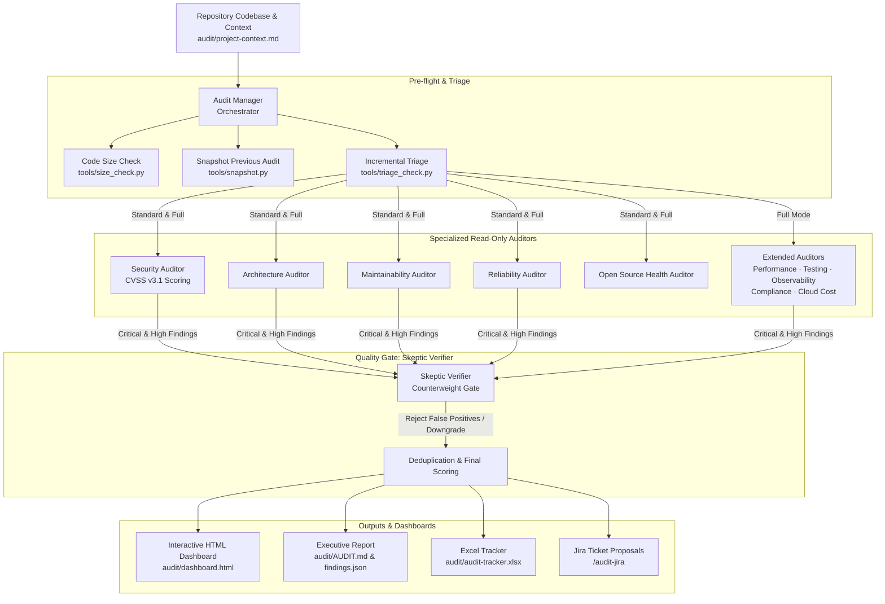

# audit-kit

Current version: **2.11.3** (see `CHANGELOG.md`). Full documentation: [docs/GUIDE.md](docs/GUIDE.md).

A portable code audit team: ten read-only auditors, a skeptic verifier that filters out false positives and a manager that consolidates their reports into a scored summary, an Excel tracker, an interactive HTML dashboard and, optionally, Jira tickets.

Drop this folder into the root of any project. It works with Claude Code, Antigravity (Gemini), Gemini CLI, Cursor, Windsurf, GitHub Copilot or any agent that can read files.

---

## The Audit Team



### Roles Breakdown

* **manager (Audit Manager & Orchestrator):** Coordinates the audit run, checks code size (`size_check.py`), archives historical snapshots (`snapshot.py`), calculates USD cost & token usage (`usage_report.py`), deduplicates findings across dimensions, and computes final 1–10 scores.
* **security (Security Auditor):** Reviews authentication, authorization, injection vectors, secrets in code/git history, and computes official FIRST.org **CVSS v3.1** Base Scores & vectors (`CVSS:3.1/...`) without disruptive terminal prompts.
* **architecture (Architecture Auditor):** Examines component boundaries, circular dependencies, domain coupling, layering violations, and modularity.
* **maintainability (Maintainability Auditor):** Identifies cognitive complexity, dead code, technical debt, duplication, and poor naming.
* **reliability (Reliability Auditor):** Detects unhandled exceptions, crash risks, resource leaks, race conditions, and missing timeouts.
* **open-source-health (Open Source Health Auditor):** Audits dependency vulnerabilities (`npm audit`, `pip-audit`), outdated libraries, unmaintained dependencies, and license risks.
* **full-mode-auditors (Extended Dimensions):** Five additional deep-dive dimensions for Full mode: *Performance & Scalability*, *Testing & QA*, *Observability & Operability*, *Data & Privacy Compliance (GDPR)*, and *Infra, CI/CD & Cloud Cost*.
* **skeptic-verifier (Skeptic Verifier & Quality Gate):** The counterweight to AI false positives. Evaluates every Critical and High finding in isolation, reads surrounding code, and issues strict verdicts (*Confirmed*, *Downgraded*, *Rejected*, *Inconclusive*). Rejected findings leave the report and do not count toward scores.

---

## Set up a new project

### 1. Install the kit

From the root of the project you want to audit:

```
curl -fsSL https://raw.githubusercontent.com/victorfigueira/audit-kit/main/get.sh | bash
```

This downloads the kit into `audit-kit/` and installs the commands for Claude Code, Antigravity, Gemini CLI, Cursor, Windsurf and GitHub Copilot. For one tool only, add its name at the end: `| bash -s -- antigravity` (or `claude`, `gemini`, `cursor`, `windsurf`, `copilot`). To pin a version, put `AUDIT_KIT_REF=v2.11.3` before `bash`.

If the project repository is public, keep the reports and the kit copy out of git:

```
echo "audit/" >> .gitignore
echo "audit-kit/" >> .gitignore
```

### 2. Fill in the project context

Reload the IDE window, then paste this into the agent chat:

```
Fill in audit/project-context.md from the README, package.json, AGENTS.md and folder structure. Mark anything you are not sure about with TO CONFIRM. Add build output and dependency folders to the out of scope paths. In "Commands auditors may run", list only the existing test and lint scripts. Do not change any other file.
```

Review the file and resolve every TO CONFIRM by hand. This step has the biggest effect on audit quality.

### 3. Run the audit

| Tool | Standard | Full | Diff | Dashboard | Jira |
|---|---|---|---|---|---|
| Claude Code | `/audit [fresh]` | `/audit-full [fresh]` | `/audit-diff [base]` | `/audit-dashboard` | `/audit-jira` |
| Antigravity | `/audit [fresh]` | `/audit-full [fresh]` | `/audit-diff [base]` | `/audit-dashboard` | `/audit-jira` |
| Gemini CLI | `/audit [fresh]` | `/audit-full [fresh]` | `/audit-diff [base]` | `/audit-dashboard` | `/audit-jira` |
| Any other agent | "Follow audit-kit/RUN.md, standard mode" | "Follow audit-kit/RUN.md, full mode" | "Follow audit-kit/RUN.md, diff mode against <base>" | "Run tools/generate_dashboard.py" | "Follow audit-kit/JIRA.md" |

### Update the kit in a project

Every audit command checks for a newer version first and offers to install it before starting (add `no-update` to skip the check, for example `/audit no-update`). You can also run `/audit-check-update` in the agent chat (Claude Code, Antigravity or Gemini CLI). It compares your version with the latest one, summarises what is new and installs it after you confirm. Without the agent, run the same `curl` command again. It replaces `audit-kit/`, refreshes the kit's own adapters and keeps `audit/` (context, reports and tracker). Reload the IDE window afterwards.

### Private repository or no curl

With the GitHub CLI:

```
gh api repos/victorfigueira/audit-kit/contents/get.sh -H "Accept: application/vnd.github.raw" | AUDIT_KIT_REPO=git@github.com:victorfigueira/audit-kit.git bash
```

Or manually: copy the `audit-kit/` folder into the project root and run `bash audit-kit/install.sh`.

## What you get

All outputs go to `audit/` in the project:

- `<dimension>.md`: one report per auditor.
- `AUDIT.md`: executive summary, scores and priorities.
- `findings.json`: consolidated findings, scores and the commit, date and kit version of each dimension's last run (input for the tracker and for incremental runs).
- `triage.md`: the plan of the last incremental run.
- `verification.md`: the skeptic verifier's verdict on each Critical and High finding. Rejected findings do not count.
- `audit-tracker.xlsx`: Summary, Findings, Run log and Legend sheets. Run log keeps one row per audit (tool, model, code size and tokens). Your Status, Owner, dates, Jira key and Notes are kept across runs.
- `jira-proposal.md`: only when you run the Jira workflow.
- `diff/`: Diff reviews only (`triage.md`, one report per auditor that ran, `DIFF-AUDIT.md`). Replaced on each Diff run; never feeds the tracker.

## Modes

- **Standard** (5 auditors): Maintainability, Open Source Health, Architecture, Security, Reliability.
- **Full** (10 auditors): the five above plus Performance and Scalability, Testing and QA, Observability and Operability, Data and Privacy Compliance, Infra, CI/CD and Cloud Cost.
- **Incremental runs.** Once a project has an audit, `/audit` and `/audit-full` only rerun the dimensions affected by changes since that audit; the rest keep their previous score and findings, marked "Carried over". Every auditor runs again when you add `fresh`, when the kit's major version changes (scoring or evidence rules), when `audit/project-context.md` changes, when the tool or model differs from the previous audit or when the previous commit is gone. Security and Open Source Health also run again when their last check is more than 30 days old. Use `fresh` for quarterly audits and before go-live.
- **Diff** (before a merge or pull request): a triage agent reads the changes against the base branch and picks which of the ten auditors to run (for example, Open Source Health only if a dependency file changed; Security whenever code or configuration changed). It shows the plan and waits for your confirmation. The result is a verdict (Ready to merge, Fix before merge, Block merge) instead of scores. The base branch defaults to the one in `audit/project-context.md`, then the remote default branch.

## Folder contents

| Path | Purpose |
|---|---|
| `RUN.md` | Manager instructions: the orchestration. Start here. |
| `VERSION` | Kit version, recorded in each audit. |
| `RULES.md` | Shared rules, severity scale, scoring, finding IDs. |
| `agents/` | One definition per auditor plus the triage agent and the skeptic verifier (tool-agnostic). |
| `templates/` | Report, summary and project context templates. |
| `JIRA.md` | Optional ticket workflow. |
| `BACKLOG.md` | Product roadmap and backlog for universal AI first-class support. |
| `UPDATE.md` | Update check used by `/audit-check-update`. |
| `docs/GUIDE.md` | User guide: how the kit works, commands, modes, updates and maintenance. |
| `tools/generate_tracker.py` | Builds the Excel tracker (needs Python 3 and `openpyxl`). |
| `tools/size_check.py` | Measures the code in scope and estimates its size in tokens. |
| `tools/usage_report.py` | Sums the tokens an audit consumed, from Claude Code or Antigravity session files. |
| `tools/triage_check.py` | Deterministic checks that decide when an incremental audit must rerun auditors. |
| `adapters/` | Thin wrappers for each tool; copied by `install.sh`. |
| `install.sh` | Installs the adapters into the project. |

## Where the adapters go

| Tool | Files created |
|---|---|
| All | `AGENTS.md` (shared rules section), `audit/project-context.md` |
| Claude Code | `.claude/agents/*-auditor.md`, `.claude/agents/audit-triage.md`, `.claude/agents/skeptic-verifier.md`, `.claude/commands/*.md`, section in `CLAUDE.md` |
| Antigravity | `.agents/skills/*/SKILL.md`, `.agents/rules/audit-rules.md`, `.agents/workflows/*.md` (legacy support), section in `GEMINI.md` (if present) |
| Gemini CLI | `.gemini/commands/*.toml` |
| Cursor | `.cursorrules`, `.cursor/rules/audit.mdc` |
| Windsurf | `.windsurfrules` |
| GitHub Copilot | `.github/copilot-instructions.md` |

Adapters only point to the files in this folder. To change how an auditor works, edit `agents/<name>.md` here, never the adapter.

## Updating

Run the install command again in the project root: it replaces `audit-kit/` with the latest version and leaves `audit/` untouched. `install.sh` refreshes adapters that point to `audit-kit/` and never touches other files with the same names.

## Projects with an older audit setup

If the project already has auditors or commands with the same names that do not point to `audit-kit/` (for example an older `.claude/agents/security-auditor.md`), `install.sh` skips them and says so. Delete or rename the old files first, then run the script.

## Requirements

- Python 3 and `openpyxl` for the tracker. `install.sh` installs `openpyxl` if it is missing; if that fails, run `pip3 install openpyxl`. Without them the audit still runs; only the Excel step is skipped.
- For Jira: the Atlassian Rovo MCP Server or a Jira API token in an environment variable.

## Safety

Auditors are read-only by instruction. Tools that support it (Claude Code) also restrict them to the tools in each adapter. Real cloud, database or production access is never part of the audit.
