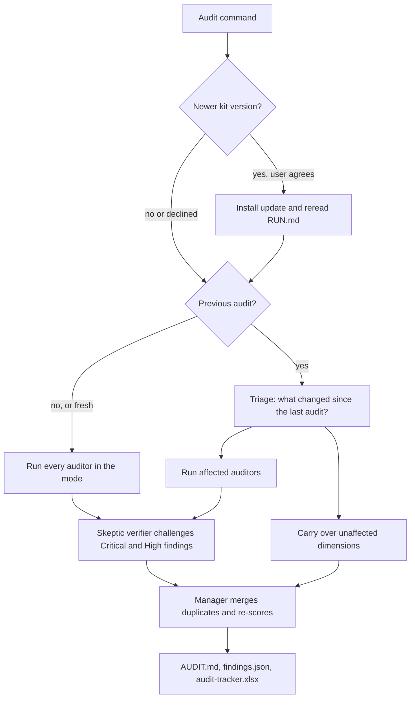
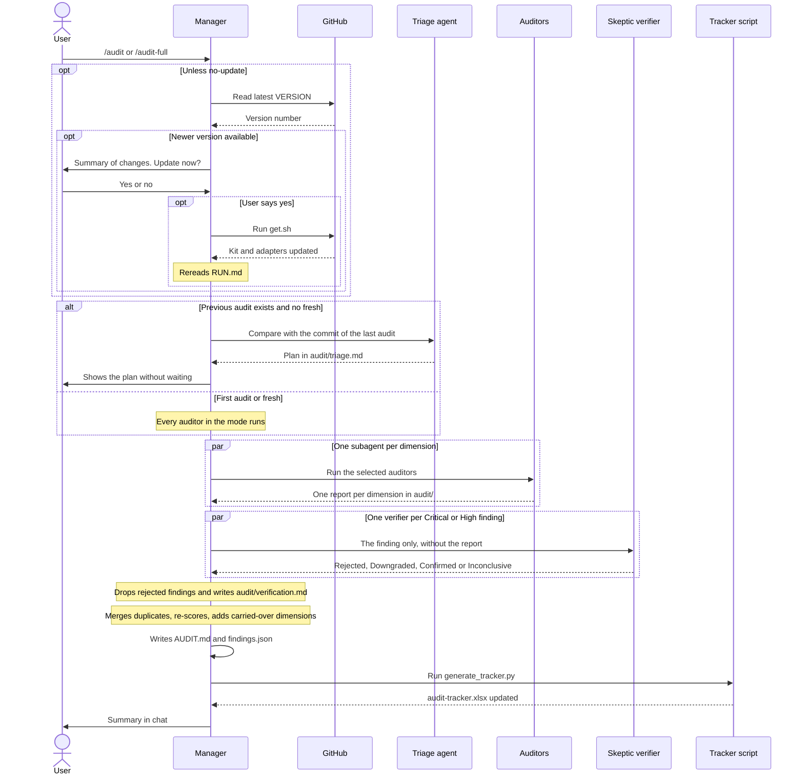
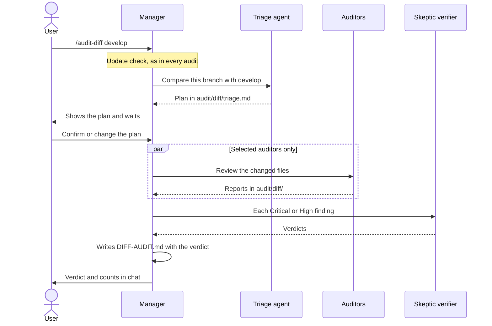
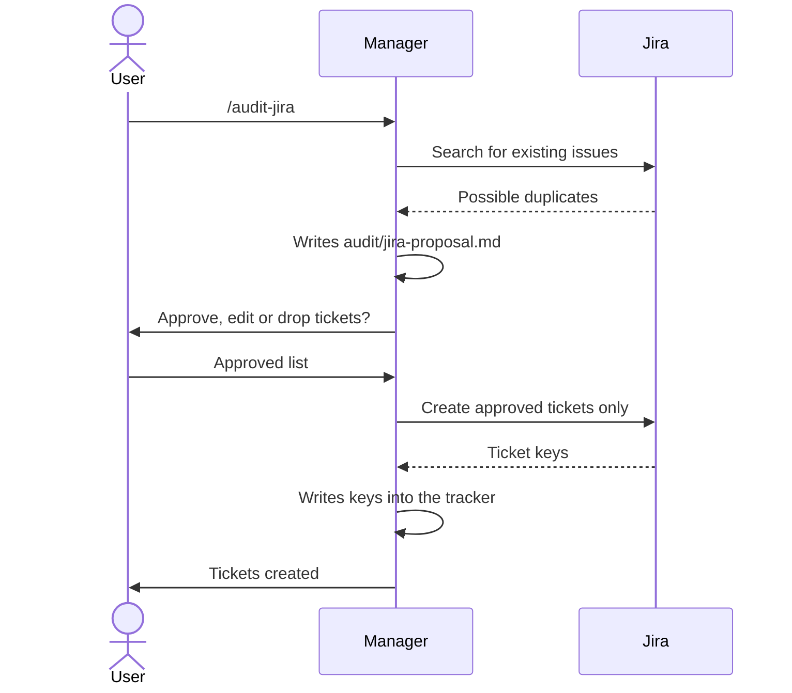

# audit-kit user guide

This guide explains how audit-kit works, how to use it day to day and how to maintain it. For a quick start, see the [README](../README.md). For the exact rules the agents follow, see [RULES.md](../RULES.md) and [RUN.md](../RUN.md).

## Contents

1. [What audit-kit is](#1-what-audit-kit-is)
2. [How it works](#2-how-it-works)
3. [Setting up a project](#3-setting-up-a-project)
4. [Commands](#4-commands)
5. [Audit modes](#5-audit-modes)
6. [Incremental runs](#6-incremental-runs)
7. [Diff reviews](#7-diff-reviews)
8. [Reading the results](#8-reading-the-results)
9. [The Excel tracker](#9-the-excel-tracker)
10. [The interactive HTML dashboard](#10-the-interactive-html-dashboard)
11. [Audit snapshots and comparisons](#11-audit-snapshots-and-comparisons)
12. [Jira tickets](#12-jira-tickets)
13. [Updates](#13-updates)
14. [Customising the kit](#14-customising-the-kit)
15. [Troubleshooting](#15-troubleshooting)
16. [Maintaining the kit](#16-maintaining-the-kit)

## 1. What audit-kit is

audit-kit is a team of AI agents that audits a code repository. It has ten auditors, one per quality dimension, a skeptic verifier that tries to knock down every Critical and High finding, and a manager that runs them, merges their reports and scores the project from 1 to 10.

It is plain Markdown plus two shell scripts and one Python script. Any agent tool that can read files can run it. Claude Code, Antigravity, Gemini CLI, Cursor, Windsurf, and GitHub Copilot get direct slash commands or dedicated rules through adapter files.

The auditors are read-only. They write only inside the `audit/` folder and never change code, install packages, connect to databases or cloud accounts or push to git.

| Dimension | Prefix | Mode |
|---|---|---|
| Maintainability | MNT | Standard and Full |
| Open Source Health | OSS | Standard and Full |
| Architecture | ARC | Standard and Full |
| Security | SEC | Standard and Full |
| Reliability | REL | Standard and Full |
| Performance and Scalability | PRF | Full |
| Testing and QA | TST | Full |
| Observability and Operability | OBS | Full |
| Data and Privacy Compliance | PRV | Full |
| Infra, CI/CD and Cloud Cost | INF | Full |

## 2. How it works



### Interaction flow

The sequence below shows who talks to whom during `/audit` or `/audit-full`, and the only point where the manager waits for you: the update question.



### Roles

There are five roles:

- **Manager.** The agent you talk to. It follows `RUN.md`: checks for updates, calls the triage agent, launches the auditors, merges their reports and writes the summary.
- **Triage agent.** Reads the git changes since a reference point and decides which auditors need to run. It never judges code quality. Its rules are in `agents/triage.md`.
- **Auditors.** One per dimension, each defined in `agents/<dimension>.md` with its scope, what is out of scope and which shell commands it may run.
- **Skeptic verifier.** The red team. It receives each Critical and High finding on its own and tries to prove it is a false positive by reading the surrounding code. Only findings that survive reach `findings.json`, the tracker and the score. Its rules are in `agents/skeptic-verifier.md`.
- **Tracker script.** `tools/generate_tracker.py` turns `audit/findings.json` into an Excel file and keeps your manual columns between runs.

When the tool supports subagents (Claude Code via dedicated agent definitions, or Antigravity via `invoke_subagent`), each auditor runs in its own isolated context and in parallel. Otherwise the manager runs them one after another and rereads each auditor file, so findings from one dimension do not leak into another.

## 3. Setting up a project

### Install

From the project root:

```
curl -fsSL https://raw.githubusercontent.com/victorfigueira/audit-kit/main/get.sh | bash
```

`get.sh` downloads the kit into `audit-kit/` and runs `install.sh`, which:

- installs `openpyxl` for the Excel tracker if it is missing (a failure never stops the install);
- creates `audit/project-context.md` if it does not exist;
- adds a short rules section to `AGENTS.md` (and `CLAUDE.md` for Claude Code, `GEMINI.md` if present for Antigravity), between `<!-- audit-kit:start -->` and `<!-- audit-kit:end -->`;
- copies the adapters for Claude Code (`.claude/`), Antigravity (`.agents/skills/`, `.agents/rules/` and legacy `.agents/workflows/`), Gemini CLI (`.gemini/commands/`), Cursor (`.cursorrules`, `.cursor/rules/`), Windsurf (`.windsurfrules`), and GitHub Copilot (`.github/copilot-instructions.md`).

To install for one tool only, add its name: `| bash -s -- claude` (or `antigravity`, `gemini`, `cursor`, `windsurf`, `copilot`). To pin a version, put `AUDIT_KIT_REF=v2.11.2` before `bash`.

Reload the IDE window afterwards so the new commands appear.

If the project repository is public, keep the reports and the kit copy out of git:

```
echo "audit/" >> .gitignore
echo "audit-kit/" >> .gitignore
```

### Fill in the project context

`audit/project-context.md` is the most important input. Every auditor reads it first. Ask the agent to fill it in:

```
Fill in audit/project-context.md from the README, package.json, AGENTS.md and folder structure. Mark anything you are not sure about as TO CONFIRM.
```

Then review it and resolve every TO CONFIRM by hand. Pay attention to:

- **Default branch:** the base for Diff reviews.
- **Sensitive areas:** authentication, payments, personal data. Auditors look harder there.
- **Commands auditors may run:** only commands that finish on their own and touch nothing outside the repository. Leave out watch modes and anything that connects to a database or cloud service.
- **Out of scope paths:** generated code, vendor folders, build output.
- **Jira project key and issue type:** only if you use the Jira workflow.

### Run the first audit

Run `/audit` for a Standard audit or `/audit-full` for all ten dimensions. The first audit of a project always runs every auditor in the mode.

## 4. Commands

| Command | What it does |
|---|---|
| `/audit` | Standard audit (5 dimensions), incremental when a previous audit exists |
| `/audit-full` | Full audit (10 dimensions), incremental when a previous audit exists |
| `/audit-diff [base]` | Reviews only the changes against a base branch and gives a merge verdict |
| `/audit-dashboard` | Generates and opens the interactive HTML dashboard (`audit/dashboard.html`) |
| `/audit-jira` | Proposes Jira tickets from the latest audit and creates them after approval |
| `/audit-check-update` | Checks for a newer kit version and installs it after confirmation |

Arguments can be combined:

| Argument | Applies to | Effect |
|---|---|---|
| `fresh` | `/audit`, `/audit-full` | Runs every auditor in the mode and skips triage |
| `no-update` | `/audit`, `/audit-full`, `/audit-diff` | Skips the update check |
| a branch name | `/audit-diff` | Uses that branch as the base |

Examples: `/audit fresh`, `/audit-full fresh no-update`, `/audit-diff develop`.

With an agent that has no slash commands, write the instruction in the chat, for example "Follow audit-kit/RUN.md, full mode".

## 5. Audit modes

| Mode | Auditors | Output | Use it for |
|---|---|---|---|
| Standard | 5 | Scores, tracker | Routine checks, before releases |
| Full | 10 | Scores, tracker | Quarterly audits, before go-live, onboarding a project |
| Diff | chosen by triage from the 10 | Merge verdict, no scores | Before merging a branch or opening a pull request |

Standard and Full write to `audit/` and update the tracker. Diff writes to `audit/diff/` and never touches the main reports or the tracker.

A Standard run after a Full one keeps the Full-only dimensions on record in `findings.json`, but leaves them out of the overall score.

## 6. Incremental runs

Once a project has an audit, `/audit` and `/audit-full` do not start from scratch. The triage agent compares the current code (including uncommitted and untracked files) with the commit of the previous audit, recorded in `audit/findings.json`, and decides for each dimension:

- **Run:** the changes touch that dimension. The auditor runs again.
- **Carry over:** nothing relevant changed. The dimension keeps its previous score, report and findings, marked "Carried over" with the commit and date of its last real run.

The plan is shown in the chat and saved in `audit/triage.md`. The manager does not wait for confirmation.

Files that git does not track yet (for example a new `ci.yml` you have not committed) cannot be compared with git, so the kit stores a hash of each one and treats it as changed only when its hash differs from the previous audit.

### What makes an auditor run

Each auditor has a rule based on the type of files that changed. A few examples:

| Changed | Auditors that run |
|---|---|
| Any source code | Security, Maintainability, Testing and QA, plus others depending on what the code does |
| `package.json` or a lockfile | Open Source Health, Security |
| CI pipeline or Dockerfile | Infra, CI/CD and Cloud Cost, Security |
| A database migration | Data and Privacy Compliance, Security, others as relevant |
| Documentation only | None |

The full table is in `agents/triage.md`. When in doubt, the triage agent runs the auditor.

### When every auditor runs anyway

These checks are made by a script, `tools/triage_check.py`, not by the agent, so they cannot be skipped by mistake. Its result is shown in the chat and in `audit/triage.md`.

- You add `fresh` to the command.
- There is no previous audit, or it was made with a different major kit version (see [Updates](#11-updates)).
- The tool or model differs from the previous audit (for example Gemini last time, Claude now, or a newer model version). Scores from different models are not comparable, so mixing them in one overall score would mislead.
- The commit of the previous audit no longer exists, for example after a rebase.
- `audit/project-context.md` changed. The kit compares a SHA-256 hash stored in `findings.json`, so this works even when `audit/` is in `.gitignore`.

Security and Open Source Health also run again when their last real check is more than 30 days old, because new vulnerabilities are published in dependencies you have not touched.

Use `fresh` for quarterly audits and before go-live, so every dimension is checked against the current code.

### Using more than one tool

Gemini and Claude apply the same rules but do not produce identical reports: the serious findings usually match, while Medium and Low findings and individual scores can differ. Each audit records the tool and model in `findings.json`, `AUDIT.md` and the tracker, and the triage agent forces a full run when they change. For a stable score history, audit each project with the same tool. To compare two tools, move the first results aside (`mv audit audit-gemini`, then recreate `audit/` with the project context) before the second run.

## 7. Diff reviews

`/audit-diff` answers one question: is this branch safe to merge?

1. The triage agent finds the base branch: the one you name, then the default branch in the project context, then the remote's default branch, then `main`, `master` or `develop`.
2. It lists the changes and picks the auditors. Security always runs when code or configuration changed.
3. The manager shows the plan and waits for you to confirm or change it.
4. The selected auditors review only the changed files, using the rest of the code for context. Problems that already existed in untouched code are mentioned in one line, not raised as findings.
5. The skeptic verifier challenges every Critical and High finding, as in a normal audit.
6. The result is `audit/diff/DIFF-AUDIT.md` with a verdict, based only on the findings that survive verification:

| Verdict | When |
|---|---|
| Ready to merge | No Critical or High findings |
| Fix before merge | At least one High |
| Block merge | At least one Critical |



If the branch has more than 100 changed files or 3,000 changed lines, the triage agent recommends a Full audit instead. Each Diff run replaces the contents of `audit/diff/`.

## 8. Reading the results

### Files

| File | Content |
|---|---|
| `audit/AUDIT.md` | Executive summary, scores, top priorities, quick wins, items to verify |
| `audit/dashboard.html` | Standalone interactive HTML/CSS/JS dashboard (scores, charts, searchable findings, snapshot diff) |
| `audit/<dimension>.md` | One report per auditor, with every finding in detail |
| `audit/findings.json` | Machine-readable findings and run metadata; input for the tracker and for incremental runs |
| `audit/triage.md` | Plan of the last incremental run |
| `audit/verification.md` | Verdicts of the skeptic verifier |
| `audit/audit-tracker.xlsx` | Tracker for follow-up |
| `audit/snapshots/` | Historical archives (`<timestamp>_<commit>/`) preserving previous audit states |

### Severities

| Severity | Meaning | Typical response |
|---|---|---|
| Critical | Exploitable, data loss, legal exposure or outage likely | Fix immediately |
| High | Serious risk or blocker; likely to cause incidents | Fix this sprint |
| Medium | Real issue with limited impact or a workaround | Plan this quarter |
| Low | Improvement or hygiene | Backlog |

### CVSS v3.1 scoring for Security findings

In addition to the qualitative 4-level severity scale, every finding in the **Security** dimension (`SEC-NNN`) includes an official FIRST.org **CVSS v3.1 Base Score and Vector**:
- **Vector format:** `CVSS:3.1/AV:[N|A|L|P]/AC:[L|H]/PR:[N|L|H]/UI:[N|R]/S:[U|C]/C:[N|L|H]/I:[N|L|H]/A:[N|L|H]`
- Evaluates attack vector (Network, Adjacent, Local, Physical), complexity, required privileges, user interaction, scope, and CIA impacts.
- Calculated and validated mathematically via `tools/cvss.py` and automatically enriched in batch during dashboard generation (`tools/generate_dashboard.py`), avoiding repetitive CLI permission prompts during audit execution.
- Rendered with interactive badges and vector inspection in `audit/dashboard.html`, and serialized in `audit/findings.json` and Jira proposals.

### Scores

Each dimension gets a score from 1 to 10 based on its findings (the scale is in `RULES.md`). The overall score is the average of the dimensions in the mode. When the manager merges duplicate findings across dimensions, it re-scores the dimensions affected and lists every change under "Score adjustments" in `AUDIT.md`.

A score can change without any code change, for example after a kit update with new rules or when a finding moves to "To verify". `AUDIT.md` explains the reason.

### Evidence and "To verify"

Only the repository counts as evidence. Every finding cites a file and line. If an agent suspects something from memory, saved notes or earlier sessions, it lists it under "To verify" with the exact check that would confirm it (for example a command to run). These items have no ID, no severity and no effect on the score until you confirm them.

### Verification of Critical and High findings

Language models tend to report problems that are not there, especially in security and architecture, because finding something feels like doing the job. The skeptic verifier is the counterweight. For each Critical and High finding of the run it receives only the finding (never the auditor's report), reads the code around it and tries to prove it is a false positive:

| Verdict | Meaning | Effect |
|---|---|---|
| Rejected | Concrete code proves the problem cannot happen, or the cited code does not exist | Leaves the findings and the score; listed in `AUDIT.md` |
| Downgraded | Real, but a cited mitigation limits it | Kept with the lower severity |
| Confirmed | The verifier could not refute it | Kept |
| Inconclusive | Depends on something outside the repository | Kept, with the check that would settle it |

The burden of proof is on the verifier. "Probably handled elsewhere" or "unlikely in practice" is not enough to reject: it must cite the `file:line` that blocks the problem. An accepted risk in the project context does not make a finding false; it stays confirmed.

All verdicts are in `audit/verification.md`, and `AUDIT.md` lists every rejected finding with its reason. If you disagree with a rejection, tell the agent "reinstate SEC-002": the finding returns with the verification "Reinstated by user", the scores are recalculated and later runs do not challenge it again.

Medium and Low findings are not verified ("Not checked"), and carried-over dimensions keep the verdicts of their last real run. Carried-over Critical and High findings that were never verified (for example, from audits before 2.0.0) are sent to the verifier on the next run.

The verifier runs on the same model as the auditors, which limits how independent it is. A second opinion from a different model is planned as a separate, optional step.

### Code size and run data

Before each Standard or Full audit, `tools/size_check.py` measures the code in scope: text files tracked or not ignored by git, without `audit/`, `audit-kit/`, binaries, lockfiles and the out-of-scope paths in the project context. It estimates the size in tokens at 4 characters per token, a rough figure that does not depend on the model.

If the code is over the threshold (400,000 estimated tokens by default, or the value in the project context) and a fresh Full audit is about to start, the manager asks whether to continue, switch to Standard or stop. Otherwise it reports the size in one line.

The result is stored as `code_size` in `findings.json` and in the header of `AUDIT.md`, next to the tool and model. These records are meant for cost estimates outside the kit: with the model, the code size and the tokens each run consumed, you can work out what a run cost and estimate what auditing another project will cost.

### Tokens consumed

At the end of each Standard or Full audit, `tools/usage_report.py` sums the tokens the run used. It reads local session files:
- **Claude Code**: reads local session files (`~/.claude/projects/<project>/`), including main session and subagents.
- **Antigravity**: reads transcript logs (`~/.gemini/antigravity/brain/<conversation-id>/.system_generated/logs/transcript.jsonl`) and child subagent conversation transcripts.

Counting only records since the audit started. It reads numbers and agent tags only, and never copies prompts or code.

The totals are split by type, because APIs price them differently: input, output, cache write and cache read. They are also split by agent (manager, each auditor, triage, verifier), identified by a tag the manager puts on the first line of every subagent prompt (`audit-kit-agent: <name>`).

The result is stored as `usage` in `findings.json`, in the "Run data" section of `AUDIT.md` and as a row of the Run log sheet in the tracker, which keeps one row per audit across runs.

Limits:
- Supported natively for Claude Code and Antigravity. For other environments (Cursor, Windsurf, Copilot, etc.), token usage can be computed deterministically using `python3 audit-kit/tools/usage_report.py --estimate` based on audited file size, or reported as unavailable rather than guessing arbitrary figures.
- Audit cost calculation: `tools/usage_report.py` automatically computes the estimated dollar cost (`usage.cost`) based on input, output, and cache rates for the detected model (Claude, Gemini, GPT-4o, etc.) and embeds it directly into `findings.json`, `AUDIT.md`, and the interactive HTML dashboard.
- The session file format is not documented and may change. If the script stops finding data, it reports "not available" rather than wrong figures.

```
python3 audit-kit/tools/size_check.py
```

### Finding IDs

IDs follow `<PREFIX>-<NNN>`, for example `SEC-003`. When an auditor runs again, it keeps the ID of every finding that is still present and numbers new findings after the highest previous ID. A fixed finding is listed under "Strengths" with its old ID.

## 9. The Excel tracker

`audit/audit-tracker.xlsx` has three sheets:

- **Summary:** scores and counts by severity. Counts are formulas, so they update when you change a status.
- **Findings:** one row per finding, with filters and drop-downs.
- **Run log:** one row per audit with date, commit, mode, run type, tool, model, kit version, code size and tokens by type. Rows are kept across runs, so it is the history to use for cost estimates.
- **Legend:** severities, statuses and effort sizes.

The manual columns (Status, Owner, Target date, Closed date, Jira key, Notes) are kept between runs, matched by finding ID. A finding that disappears from a later audit stays in the sheet with the status "Not found in latest audit", so you can confirm it was fixed before closing it. A finding that the skeptic verifier rejects in a later run gets the status "False positive" with the reason. Neither status counts in the Summary totals. The last column, Verification, shows the verifier's verdict (for example "Downgraded from Critical"). Findings from carried-over dimensions are copied forward, so they are never marked by mistake.

The tracker needs Python 3 and `openpyxl`. To rebuild it by hand:

```
python3 audit-kit/tools/generate_tracker.py
```

## 10. The interactive HTML dashboard

`audit/dashboard.html` is a standalone, interactive dashboard generated at the end of each audit run.

Features:
- **Zero dependencies & file:// compatible**: Opens directly in any browser without needing a web server, Node.js, Python server, or an internet connection.
- **Executive score & stat cards**: Real-time gauge for the overall score, severity breakdown badges, and code size metrics.
- **Dimension score breakdown**: Visual progress bars per dimension; clicking a dimension immediately filters the findings table.
- **Findings explorer**: Live search box filtering across ID, title, file path, and description, paired with interactive severity filter pills (Critical, High, Medium, Low).
- **Snapshot evolution & diff viewer**: Select and compare any historical snapshot against the active audit to inspect resolved findings, new findings, and dimension score deltas.

To regenerate or open the dashboard manually:
```bash
python3 audit-kit/tools/generate_dashboard.py --open
```
Or run `/audit-dashboard` in your AI agent chat.

## 11. Audit snapshots and comparisons

Before any new audit run writes fresh reports, `RUN.md` automatically archives the previous audit state to `audit/snapshots/<TIMESTAMP>_<COMMIT>/` using `tools/snapshot.py`.

### Snapshot features:
- **Non-destructive**: Preserves `AUDIT.md`, `findings.json`, `verification.md`, `triage.md`, `audit-tracker.xlsx`, and dimension reports. `audit/project-context.md` remains intact at the root.
- **List snapshots**:
  ```bash
  python3 audit-kit/tools/snapshot.py list
  ```
- **Compare runs**:
  Compare the current audit against the latest snapshot (or two specific snapshots):
  ```bash
  python3 audit-kit/tools/snapshot.py compare
  python3 audit-kit/tools/snapshot.py compare <snapshot_base> [snapshot_target]
  ```
  The diff engine reports:
  - 🟢 **Resolved findings**: issues fixed since the base snapshot.
  - 🔴 **New findings**: issues introduced in the target audit.
  - 🟡 **Persistent findings**: issues still present, highlighting severity changes.
  - **Score deltas**: overall and per-dimension score variations.

## 12. Jira tickets

After an audit, `/audit-jira` follows `JIRA.md`:

1. Selects open Critical and High findings, plus Medium ones that block other work, and groups those with the same root cause (maximum 15 tickets).
2. Searches Jira for existing issues on the same topic to avoid duplicates.
3. Writes `audit/jira-proposal.md` and **stops for your approval**.
4. Creates only the approved tickets and writes each key into the tracker.



It connects through the Atlassian Rovo MCP Server, or the Jira REST API with a token in the `JIRA_API_TOKEN` environment variable. Tokens are never written to any file. In Claude Code, add the MCP server per project rather than for the user, so work and personal Jira accounts do not mix:

```
claude mcp add --transport http jira https://mcp.atlassian.com/v1/mcp/authv2
```

Then run `/mcp` to sign in, and add the project key and issue type to `audit/project-context.md`.

## 13. Updates

### Automatic check

Every audit command checks GitHub for a newer version first. If there is one, the manager summarises what is new and asks whether to update. If you agree, it installs the update, rereads `RUN.md` and runs the audit with the new version. If you decline, or GitHub cannot be reached, the audit runs with the installed version. Add `no-update` to skip the check, for example when you want two audits made with the same kit version.

### Manual update

- In the agent chat: `/audit-check-update`.
- In the terminal, from the project root: the same `curl` command used to install.

Both replace `audit-kit/`, refresh the kit's own adapters and leave `audit/` untouched. Reload the IDE window if the installer reports added or updated adapters.

### Version numbers

The kit follows `MAJOR.MINOR.PATCH`, stored in `VERSION`:

| Change | Example | Effect on the next audit |
|---|---|---|
| Major | 1.x → 2.0 | Changes to scoring or evidence rules. Every auditor runs again, because old scores are not comparable. |
| Minor | 1.5 → 1.6 | New features. Incremental runs continue. |
| Patch | 1.6.0 → 1.6.1 | Fixes and documentation. Incremental runs continue. |

The installed version is recorded in each audit (`kit_version` in `findings.json` and the header of `AUDIT.md`).

## 14. Customising the kit

- **Change how an auditor works:** edit `agents/<dimension>.md` in the kit repository and release a new version. Never edit the adapters in `.claude/`, `.agents/`, `.gemini/`, `.cursor/`, `.cursorrules`, `.windsurfrules` or `.github/`; they only point to the kit and the installer refreshes them.
- **Change the rules for one project only:** use `audit/project-context.md` (accepted risks, sensitive areas, out of scope paths, allowed commands). It is never overwritten.
- **Projects with an older audit setup:** the installer refreshes files that point to `audit-kit/` and skips any other file with the same name, reporting "skip (not an audit-kit file)". Delete or rename the old files, then run the installer again.
- **Comparing two tools:** see [Using more than one tool](#using-more-than-one-tool).

## 15. Troubleshooting

| Problem | Cause and fix |
|---|---|
| The commands do not appear | Reload the IDE window after installing or updating. |
| No Excel file after the audit | `openpyxl` is missing. Run `python3 -m pip install --user openpyxl` (add `--break-system-packages` if pip reports an externally managed environment). |
| "skip (not an audit-kit file)" during install | An older file with the same name exists. Delete or rename it and run the installer again. |
| A finding you believe is real was rejected | Read its counter-evidence in `audit/verification.md`. If the verifier is wrong, tell the agent "reinstate <ID>". |
| Every incremental run reruns all auditors | Check `audit/triage.md` for the forced-run reason: an old major version, a changed project context, a different tool or model or a missing commit. |
| A finding the agent is sure about is under "To verify" | It does not rest on the repository. Run the suggested check; if it confirms the problem, tell the agent so it becomes a finding. |
| The update check says GitHub cannot be reached | Network or proxy issue. The audit continues with the installed version. |
| A new auditor is not available as a subagent after an update | Claude Code loads subagents at session start. The manager runs it from its file this time; restart the session for the next audit. |

## 16. Maintaining the kit

This section is for whoever publishes new versions.

### Repository layout

| Path | Purpose |
|---|---|
| `RUN.md` | Manager orchestration |
| `RULES.md` | Shared rules, severity scale, scoring, IDs |
| `UPDATE.md` | Update check |
| `JIRA.md` | Ticket workflow |
| `agents/` | Ten auditors, the triage agent and the skeptic verifier |
| `templates/` | Report, summary, diff summary and project context templates |
| `tools/generate_tracker.py` | Excel tracker |
| `tools/size_check.py` | Code size estimate |
| `tools/triage_check.py` | Forced-run checks for incremental audits |
| `tools/usage_report.py` | Tokens consumed by a run |
| `adapters/` | Thin wrappers for each tool |
| `get.sh`, `install.sh` | Download and install |
| `VERSION`, `CHANGELOG.md` | Version and history |
| `docs/GUIDE.md` | This guide |

### Releasing a version

1. Make the change.
2. Decide the version number with the table in [Version numbers](#version-numbers). Any change to scoring, severities or evidence rules is a major version.
3. Update `VERSION`, the "Current version" line and the `AUDIT_KIT_REF` example in `README.md`, and add an entry at the top of `CHANGELOG.md`. The update check shows these entries to users, so write them for users.
4. If a new adapter is needed, add it for all supported tools (Claude Code, Antigravity, Gemini CLI, Cursor, Windsurf, GitHub Copilot).
5. Test the installer in an empty git repository: `bash audit-kit/install.sh` twice (the second run should report "up to date").
6. Commit, tag and push:

```
git add . && git commit -m "vX.Y.Z: short description"
git tag vX.Y.Z && git push && git push --tags
```

Projects pick up the new version at their next audit.
